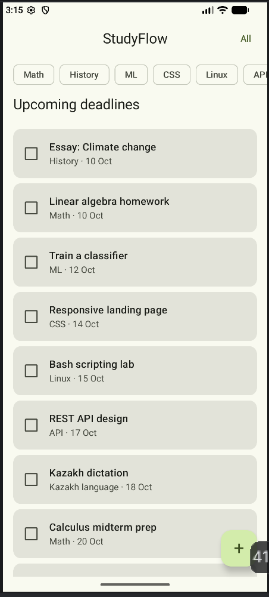
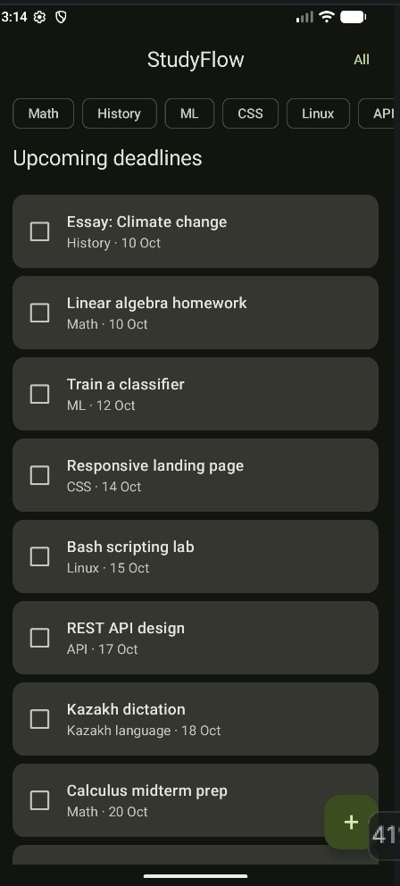
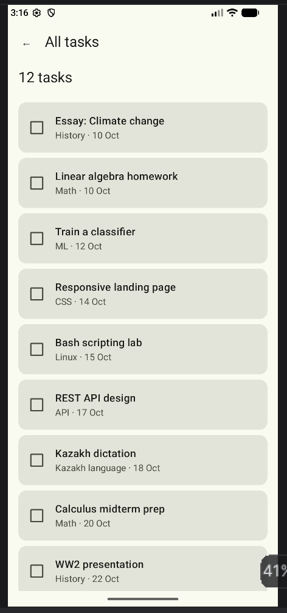
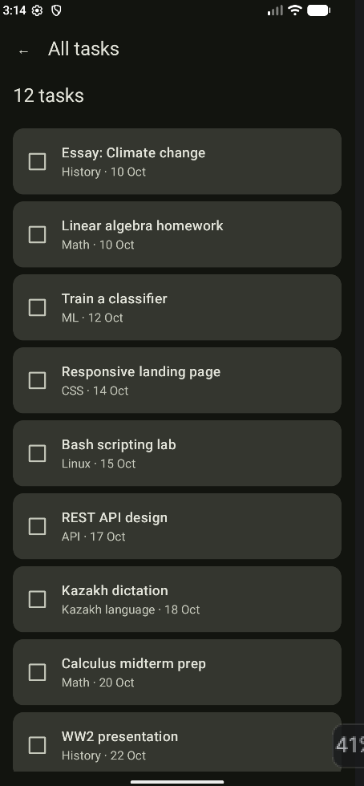
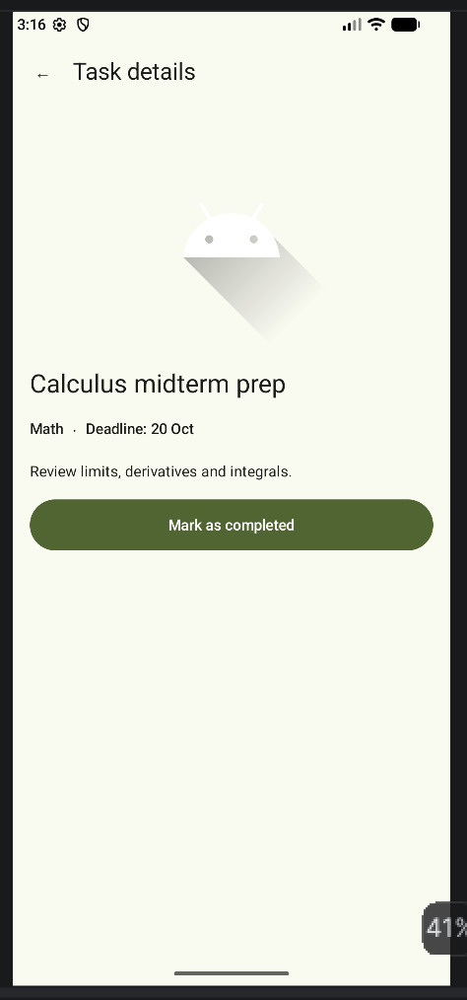
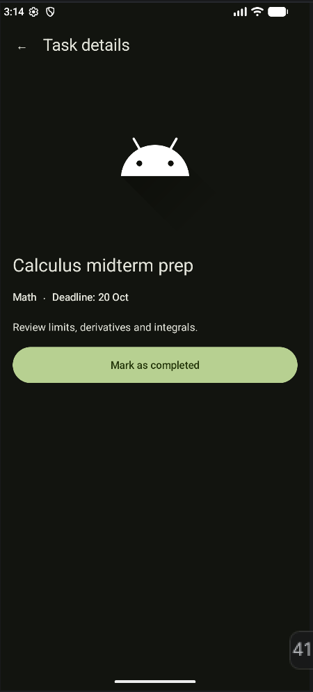
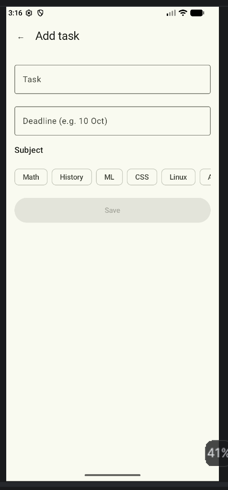
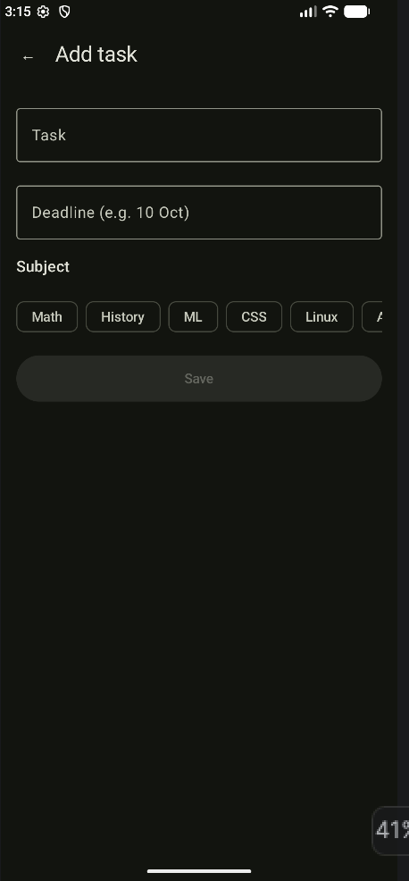

# Deadliner

Deadliner is a study task and deadline tracker for university and college students. It keeps subjects and assignments with deadlines in one place, so students can see what is coming up and mark tasks as done.

- **SIS 3:** the screens of the app with Jetpack Compose (layout and styling).
- **SIS 4:** the same app refactored to MVVM (ViewModel, UI state, repository, lifecycle logs).

Data is kept in memory; saving to disk is out of scope for these assignments.

## Screens

| Screen | Light | Dark |
| --- | --- | --- |
| **Home**: subject chips (`LazyRow`) and upcoming deadlines (`LazyColumn`) |  |  |
| **All tasks**: full list of tasks with an empty state |  |  |
| **Task details**: receives the task `id`, "Mark as completed" toggle |  |  |
| **Add task**: title, deadline, subject chips, Save |  |  |

## Sketch vs. final app

Sketches with labeled blocks (Scaffold, TopAppBar, Column, Row, LazyRow, LazyColumn, Card) are in [`design/Deadliner.png`](design/Deadliner.png). They were the first commit of the repository.

What changed between the sketch and the app:

| Sketch | Final app | Why |
| --- | --- | --- |
| "+" button drawn inside the top bar | `FloatingActionButton` at the bottom right | A FAB is the standard Material pattern and easier to tap |
| Subject chips wrapped into 3 rows on Add Task | One horizontal `LazyRow` | `LazyRow` scrolls sideways and does not wrap |
| Circle icon in the task card | `Checkbox` | Shows completed state without extra icon dependencies |
| Task List reached from nowhere | "All" button in the Home top bar | Gives the list screen a clear entry point |
| Back arrow icon | `←` text inside an `IconButton` | Avoids the icons library; the button is still 48 dp |

## How the requirements are covered (SIS 3)

- **Layout:** every screen uses `Scaffold` + top app bar; non-start screens have a working back button. Lists use `LazyColumn`, subjects use `LazyRow`. Long titles use `maxLines` + `TextOverflow.Ellipsis`; empty lists show a "No tasks yet" state.
- **Styling:** custom color scheme generated with Material Theme Builder, defined only in `ui/theme`. Screens use `MaterialTheme.colorScheme` and `MaterialTheme.typography`. Spacing comes from the `Spacing` object (4, 8, 16, 24 dp, plus a 48 dp touch target). Dark mode is supported.
- **Structure:** reusable composables `TaskCard`, `SubjectChip`, `SectionHeader`, each with light and dark `@Preview`; every screen also has previews.
- **Navigation:** Navigation Compose with routes `home`, `list`, `detail/{taskId}`, `add`. The detail screen gets `taskId` as a navigation argument and finds the task by id.

## Architecture (SIS 4: MVVM)

The architecture was planned before the refactor (first SIS 4 commit): diagram in [`design/architecture.png`](design/architecture.png), one traced click in [`design/trace.md`](design/trace.md).

```
View (waiter)                    ViewModel (chef)               Model (fridge)
HomeRoute -> HomeScreen          TasksViewModel                 TaskRepository
TaskListRoute -> TaskListScreen   _uiState (MutableStateFlow)    tasks list
TaskDetailRoute -> TaskDetailScreen uiState (StateFlow)          delay(), shouldFail
AddTaskRoute -> AddTaskScreen
      | events (lambdas) ------------>  | ---- suspend functions ---->  |
      | <------ uiState (state) ------- | <---- List<Task> / error ---- |
```

Search, subject filter, favorites and the add-task form now live in the ViewModel, not in the screens. Screens are stateless: they get a `TasksUiState` and send events up.

### Trace one click: typing "ess" in the search field
1. `HomeScreen` text field calls `onSearchChange("ess")`.
2. That is `viewModel::onSearchChange`, passed in `HomeRoute` (ui/screens/HomeScreen.kt).
3. `TasksViewModel.onSearchChange` runs `_uiState.update { it.copy(searchQuery = ..., visibleTasks = filter(...)) }`.
4. `uiState` emits a new state. `HomeRoute` collects it with `collectAsStateWithLifecycle()`.
5. `HomeScreen` is recomposed and shows only the matching tasks (or "No tasks found").

### The four states
Loading (spinner), content (list), empty ("No tasks found"), error (message + Retry).
Each one has a `@Preview` in `HomeScreen.kt`, built from a fake `TasksUiState`.

### Proof: rotation
Logcat after launching the app and rotating the emulator twice (portrait -> landscape -> portrait).
Command: `adb logcat -s Lifecycle VM` (timestamps shortened).

```
01:09:48.663 D Lifecycle: MainActivity onCreate
01:09:48.823 D Lifecycle: MainActivity onStart
01:09:48.833 D Lifecycle: MainActivity onResume
01:09:48.921 D VM      : TasksViewModel init
                                                   <- first rotation
01:09:51.460 D Lifecycle: MainActivity onPause
01:09:51.469 D Lifecycle: MainActivity onStop
01:09:51.539 D Lifecycle: MainActivity onDestroy
01:09:51.554 D Lifecycle: MainActivity onCreate
01:09:51.559 D Lifecycle: MainActivity onStart
01:09:51.562 D Lifecycle: MainActivity onResume
                                                   <- second rotation
01:09:56.931 D Lifecycle: MainActivity onPause
01:09:56.990 D Lifecycle: MainActivity onStop
01:09:57.068 D Lifecycle: MainActivity onDestroy
01:09:57.085 D Lifecycle: MainActivity onCreate
01:09:57.087 D Lifecycle: MainActivity onStart
01:09:57.087 D Lifecycle: MainActivity onResume
```

`TasksViewModel init` appears only once, at the start. There is no `init` and no `onCleared` after either rotation.

For contrast, when the Activity is closed for real (Back / app stopped), `onCleared` appears right before `onDestroy`, and the next launch prints `init` again:

```
01:09:33.766 D Lifecycle: MainActivity onStop
01:09:33.933 D VM      : TasksViewModel onCleared
01:09:33.933 D Lifecycle: MainActivity onDestroy
...
01:09:48.921 D VM      : TasksViewModel init
```

Explanation:
> When the screen rotates, Android destroys MainActivity (`onDestroy`) and creates a new one (`onCreate`), so the log shows a full lifecycle each time. The ViewModel is not stored inside the Activity but in a separate store, so Android hands the same instance to the new Activity and `onCleared` is not called. The search text, the selected chip and the favorites live in `_uiState` inside the ViewModel, so they survive the rotation. The new Activity just draws the screen again from the same `uiState`.

## Project structure

```
app/src/main/java/com/example/deadliner/
├── data/            Task data class, sample data, TaskRepository (delay, simulated error)
├── ui/
│   ├── components/  TaskCard, SubjectChip, SectionHeader
│   ├── screens/     Route (knows ViewModel) + stateless Screen + previews:
│   │                Home, TaskList, TaskDetail, AddTask
│   ├── theme/       Color, Theme, Type, Spacing
│   ├── TasksUiState.kt   TasksUiState + TaskDraft
│   ├── TasksViewModel.kt state + events + search/filter logic
│   └── AppNavigation.kt
└── MainActivity.kt  lifecycle logs
design/              sketches (SIS 3), architecture diagram and trace (SIS 4)
screenshots/         light and dark screenshots
```

## How to run

1. Open the project in Android Studio.
2. Wait for Gradle sync to finish.
3. Press Run on an emulator or a connected device.

## AI usage

See [AI_USAGE.md](AI_USAGE.md).
